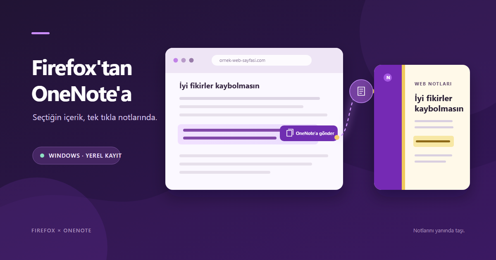

<div align="center">

# Firefox OneNote Quick Save

**Save selected text and screenshots from Firefox straight to OneNote.**

Windows · Firefox 142+ · OneNote desktop · English & Türkçe

[Get the latest release](https://github.com/slaweally/Firefox-OneNote-Quick-Save/releases/latest) · [Report a bug](https://github.com/slaweally/Firefox-OneNote-Quick-Save/issues/new?template=bug_report.yml) · [Privacy](PRIVACY.md)



</div>

> **AMO status:** v1.3.1 has been submitted to Mozilla and is awaiting review.
> Until it is approved, the XPI attached to the GitHub release is not a
> signed, directly installable Firefox add-on.

## What it does

Save useful things you find on the web without switching apps and pasting
manually. Choose a section in your OneNote notebook; the active Firefox tab
title becomes the new page title.

- **Save selected text:** right-click your selection and choose a OneNote
  section.
- **Save a selection as an image:** send the visible selected area to a
  OneNote section.
- **Write a quick note:** use the popup to edit a note, add selected text or an
  image, and save.
- **Use your language:** choose English or Türkçe on first launch.

## Install

### 1. Install the Firefox extension

Once Mozilla approves the submission, install it from
[Firefox Add-ons (AMO)](https://addons.mozilla.org/en-US/firefox/addon/onenote-quick-save/).
For now, see the [v1.3.1 release](https://github.com/slaweally/Firefox-OneNote-Quick-Save/releases/tag/v1.3.1)
for the submitted XPI and source code. The unsigned XPI is for review and
testing only; regular Firefox requires Mozilla's signature for installation.

### 2. Connect the local OneNote app (Windows)

Requirements: Windows, Firefox 142 or later, and the OneNote **desktop** app
installed and signed in.

Run this command in PowerShell:

```powershell
irm https://raw.githubusercontent.com/slaweally/Firefox-OneNote-Quick-Save/main/install.ps1 | iex
```

The installer downloads the bridge source, compiles it with the Windows .NET
Framework compiler, and registers Firefox Native Messaging for your Windows
user. It does not download a prebuilt executable and does not require
administrator access. Restart Firefox after it finishes.

**Before AMO approval:** download the release source ZIP, install the bridge,
then open `about:debugging#/runtime/this-firefox` in Firefox. Select **Load
Temporary Add-on…** and choose `manifest.json` from the extracted source
folder. Firefox removes temporary add-ons when it restarts, so reload it for
each test session.

## How it works

```text
Firefox extension ── Native Messaging (this computer) ── OneNote desktop app
```

No Azure app registration, Microsoft Graph permission, separate account
sign-in, or project cloud service is involved. The bridge uses the local
OneNote desktop automation interface to list sections and create pages.

## Privacy

The extension only accesses content when you explicitly use a save action. It
passes selected text, the selected visible-area image, or the note you entered
to the local OneNote bridge, along with the tab title and destination section.
The extension does not read Firefox saved passwords, autofill data, or
browsing history, and this project does not receive the content.

The language and destination preference are stored in Firefox's local
extension storage. OneNote may sync pages using your Microsoft account and
OneNote settings; the extension does not control that. Read the full
[privacy policy](PRIVACY.md).

## Troubleshooting

| Problem | Try this |
| --- | --- |
| No OneNote sections appear | Open and sign in to the Windows OneNote desktop app, then refresh sections in the extension. |
| “Local OneNote bridge” is missing | Run the PowerShell setup command again and restart Firefox. |
| The add-on is unavailable in AMO | Mozilla review is still pending. Use temporary loading for testing; the unsigned XPI will not install normally. |
| Firefox says it is incompatible | Use Firefox 142 or newer. |

## Help improve it

Found a problem? [Open a bug report](https://github.com/slaweally/Firefox-OneNote-Quick-Save/issues/new?template=bug_report.yml).
Have an idea? [Suggest a feature](https://github.com/slaweally/Firefox-OneNote-Quick-Save/issues/new?template=feature_request.yml).
Please include your Windows version and Firefox version, but never include
private notes, account details, or passwords.

If this project is useful to you, consider giving the repository a ⭐. Stars
help other OneNote and Firefox users discover it.

## Build from source

PowerShell in the project directory:

```powershell
.\package-xpi.ps1
```

Builds the extension package under `dist`. To also create the GitHub source
archive, run `.\package-release.ps1`. The XPI includes only extension files;
the local Windows bridge is installed separately.

## Firefox OneNote Quick Save (Türkçe)

**Firefox'ta seçtiğiniz metni ve görüntüleri doğrudan OneNote'a kaydedin.**

Windows · Firefox 142+ · OneNote masaüstü · Türkçe ve English

[Son sürüm](https://github.com/slaweally/Firefox-OneNote-Quick-Save/releases/latest) · [Hata bildir](https://github.com/slaweally/Firefox-OneNote-Quick-Save/issues/new?template=bug_report.yml) · [Gizlilik](PRIVACY.md)

> **AMO durumu:** v1.3.1 Mozilla incelemesine gönderildi; onay bekliyor.
> Onaylanana kadar GitHub sürümündeki XPI, Firefox'a doğrudan kurulabilen
> imzalı bir eklenti değildir.

## Ne işe yarar?

Web'de bulduğunuz içeriği uygulamalar arasında kopyalayıp yapıştırmadan
OneNote'a kaydedin. OneNote bölümünü seçin; yeni sayfanın başlığı etkin
Firefox sekmesinden alınsın.

- **Seçili metni kaydedin:** Metni seçip sağ tıklayın ve OneNote bölümünü seçin.
- **Seçili alanı görüntü olarak kaydedin:** Ekranda görünen seçimi bir OneNote
  bölümüne gönderin.
- **Hızlı not yazın:** Eklenti penceresinde notunuzu düzenleyin; seçili metin
  veya görüntü ekleyip kaydedin.
- **Dilinizi seçin:** İlk açılışta Türkçe veya English seçin.

## Kurulum

### 1. Firefox eklentisini yükleyin

Mozilla incelemesi onaylandığında eklentiyi
[Firefox Eklentileri'nden (AMO)](https://addons.mozilla.org/en-US/firefox/addon/onenote-quick-save/)
yükleyebilirsiniz. Şimdilik [v1.3.1 sürümünde](https://github.com/slaweally/Firefox-OneNote-Quick-Save/releases/tag/v1.3.1)
gönderilen XPI ve kaynak kodu var. İmzasız XPI inceleme ve test içindir; normal
Firefox'a kurulum için Mozilla imzası gerekir.

### 2. Yerel OneNote bağlantısını kurun (Windows)

Gereksinimler: Windows, Firefox 142 veya üzeri ve kurulu, hesabınızın açık
olduğu OneNote **masaüstü** uygulaması.

PowerShell'de şu komutu çalıştırın:

```powershell
irm https://raw.githubusercontent.com/slaweally/Firefox-OneNote-Quick-Save/main/install.ps1 | iex
```

Kurulum betiği köprü kaynak kodunu indirir, Windows .NET Framework derleyicisi
ile derler ve geçerli Windows kullanıcısı için Firefox Native Messaging
kaydını oluşturur. Önceden derlenmiş bir EXE indirmez ve yönetici izni
gerektirmez. Kurulum bitince Firefox'u yeniden başlatın.

**AMO onayı öncesi deneme:** Sürümün kaynak ZIP dosyasını indirin, köprüyü
kurun, Firefox'ta `about:debugging#/runtime/this-firefox` adresini açın.
**Geçici Eklenti Yükle…** düğmesine tıklayıp açılmış kaynak klasöründeki
`manifest.json` dosyasını seçin. Firefox geçici eklentileri yeniden başlarken
kaldırır; her test oturumunda yeniden yükleyin.

## Nasıl çalışır?

```text
Firefox eklentisi ── Native Messaging (bu bilgisayarda) ── OneNote masaüstü
```

Azure uygulama kaydı, Microsoft Graph izni, ayrıca hesap girişi veya projeye
ait bir bulut servisi kullanılmaz. Köprü, OneNote masaüstü uygulamasının yerel
otomasyon arayüzüyle bölümleri listeler ve sayfaları oluşturur.

## Gizlilik

Eklenti içeriğe yalnızca kaydetme eylemini siz başlattığınızda erişir. Seçili
metin, seçili görünür alanın görüntüsü veya yazdığınız not; sekme başlığı ve
hedef bölümle birlikte bu bilgisayardaki OneNote köprüsüne aktarılır. Eklenti
Firefox kayıtlı parolalarını, otomatik doldurma verilerini veya gezinme
geçmişini okumaz; proje bu içeriği almaz.

Dil ve hedef bölüm tercihi Firefox'un yerel eklenti depolamasında tutulur.
OneNote sayfaları Microsoft hesabınız ve OneNote ayarlarınıza göre
eşitleyebilir; eklenti bunu yönetmez. Ayrıntılar için [gizlilik politikasını](PRIVACY.md)
okuyun.

## Sorun giderme

| Sorun | Deneyin |
| --- | --- |
| OneNote bölümü görünmüyor | Windows OneNote masaüstü uygulamasını açıp oturum açın; sonra eklentiden bölümleri yenileyin. |
| Yerel OneNote köprüsü bulunamıyor | PowerShell kurulum komutunu tekrar çalıştırıp Firefox'u yeniden başlatın. |
| AMO'da eklenti bulunmuyor | Mozilla incelemesi sürüyor olabilir. Test için geçici yüklemeyi kullanın; imzasız XPI normal şekilde kurulamaz. |
| Firefox eklentiyle uyumsuz diyor | Firefox 142 veya üzerini kullanın. |

## Katkı ve geri bildirim

Sorunla karşılaştınız mı? [Hata bildirimi açın](https://github.com/slaweally/Firefox-OneNote-Quick-Save/issues/new?template=bug_report.yml).
Bir fikriniz mi var? [Özellik önerin](https://github.com/slaweally/Firefox-OneNote-Quick-Save/issues/new?template=feature_request.yml).
Windows ve Firefox sürümünüzü yazabilirsiniz; özel not, hesap bilgisi veya
parola paylaşmayın.

Proje işinize yarıyorsa depoya ⭐ bırakmayı düşünebilirsiniz. Yıldızlar,
eklentiye ihtiyaç duyabilecek diğer Firefox ve OneNote kullanıcılarının projeyi
keşfetmesine yardımcı olur.

## Kaynak koddan paketleme

Proje klasöründe PowerShell açıp çalıştırın:

```powershell
.\package-xpi.ps1
```

Eklenti paketini `dist` klasöründe oluşturur. GitHub kaynak arşivini de
oluşturmak için `.\package-release.ps1` komutunu çalıştırın. XPI yalnızca
eklenti dosyalarını içerir; Windows köprüsü ayrıca kurulur.
